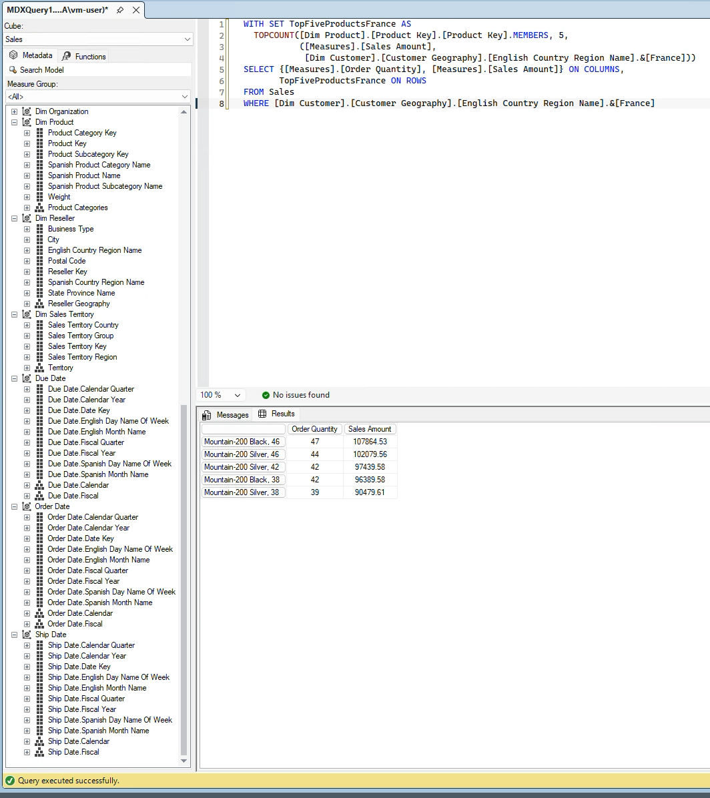

# Data Warehouse Design on AdventureWorksDW2014 (CprE/SE 4140)

A multidimensional data warehouse design, its implementation as a SQL Server Analysis Services (SSAS) cube, and MDX queries against it.

| | |
|---|---|
| Period | September – October 2026 (Fall 2026, in progress) |
| Team | Individual |
| Stack | SQL Server, SSAS (multidimensional), MDX, MultiDim notation, draw.io |

## Overview

- **Problem:** AdventureWorksDW2014 holds sales data across many tables. Business questions such as "sales by product category, by year, for customers in one country" need a model that makes those slices direct.
- **Approach:** a combined analysis-driven and source-driven design. I mapped each requirement in the project handout to facts, measures, dimensions and hierarchies, then matched each one to the tables available in the source.

| Folder | Contents |
|---|---|
| `dataproj1/Project_1/` | Project 1: MultiDim conceptual schema (PDF and editable draw.io), exported SSAS project, design notes |
| `lab3/` | Lab 3: MDX queries against the cube, with a result screenshot |

## My role

Individual work: requirements analysis, the conceptual schema, the cube, the MDX queries, and the write-up.

## What I learned

- Conceptual modeling with MultiDim: facts, levels, and hierarchies.
- Role-playing dimensions. One Date dimension serves as order date, due date and ship date.
- Parent-child hierarchies for self-referencing tables (employee supervision, organization structure).
- When not to link a dimension to a fact. SSAS related Organization to Internet Sales through the currency key automatically; I removed that link because it did not mean what it implied.
- MDX: members, tuples, `CHILDREN`, `ASCENDANTS`, `ANCESTOR`, and slicing with `WHERE`.

## Resources used

- Vaisman and Zimányi, *Data Warehouse Systems: Design and Implementation* (MultiDim notation)
- Microsoft SSAS and MDX documentation
- Course labs 1–3 and the Project 1 handout

## Results

- A cube with 2 measure groups (Internet Sales, Sales Quota) and 8 dimensions (Date, Product, Customer, Sales Territory, Employee, Reseller, Currency, Organization).
- All 9 requirements in the handout are covered; the mapping is in [`dataproj1/Project_1/README.txt`](dataproj1/Project_1/README.txt).
- Schema: [`Project1_MultiDim.pdf`](dataproj1/Project_1/Project1_MultiDim.pdf)

## Limitations and next steps

- Hierarchies were built without defining attribute relationships between every level. SSAS raises a best-practice warning; results are unaffected, but query performance could improve.
- Sales quota is recorded per employee per quarter, so analysis below the quarter level is not meaningful.
- The deployment wizard was unavailable on the lab VM, so the cube is exported as a full SSAS project instead of an XMLA script.
- Reseller and Organization are not linked to a fact yet. They are ready to be related once a reseller sales or finance fact is added.
